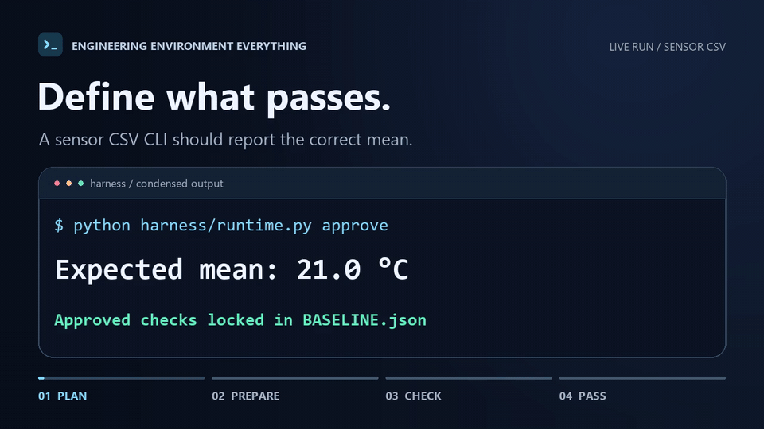

# Engineering Environment Everything

**English** · [한국어](README.ko.md)

An agent skill that turns an engineering request into a researched plan, a working development environment, and executable acceptance checks. The agent writes the checks up front, prepares the environment after you approve the plan, then implements and verifies the work in a loop.

Maintained by [mango-leo on GitHub](https://github.com/mango-leo?tab=repositories).

## 9.6-second demo



[Open the MP4](docs/media/eee-demo.mp4)

## How it works

1. **Research and plan.** The planning model inspects the project and available tools, researches unfamiliar requirements, and writes the setup commands, constraints, and acceptance checks. Each check includes examples that should pass and fail.
2. **Review the plan.** You review the assumptions, constraints, acceptance criteria, and time budget once. **Before approving, read each `setup` command in `harness/CHECKS.json`.** If a readiness check fails, `prepare` can run the approved setup command.
3. **Prepare and calibrate.** The runner records the approved plan and checks. It verifies that the environment is ready, then runs the passing and failing examples to confirm that the checks distinguish correct behavior from incorrect behavior.
4. **Implement and verify.** The implementation model works in small steps and uses failed checks to guide fixes. A final `PASS` requires every mandatory check to pass on the current files. If time runs out, progress stalls, or an external dependency blocks the work, the agent records the evidence and where to resume.

The agent uses a higher reasoning setting for planning and a lower setting for implementation when the host supports model selection. By default, environment preparation and implementation share a 60-minute budget that you can adjust.

## Install

The runner requires **Python 3.9+** and uses the standard library. Project-specific tools depend on the work and are listed in the plan.

Download or clone this repository. Run the following commands from its root, replacing the target path with your project directory.

**Windows PowerShell**

```powershell
$target = 'C:\path\to\your-project'
New-Item -ItemType Directory -Force "$target\.agents\skills", "$target\.claude\skills" | Out-Null
Copy-Item -Recurse '.agents\skills\engineering-environment-everything' "$target\.agents\skills\"
Copy-Item -Recurse '.claude\skills\engineering-environment-everything' "$target\.claude\skills\"
```

**Bash**

```bash
target=/path/to/your-project
mkdir -p "$target/.agents/skills" "$target/.claude/skills"
cp -R .agents/skills/engineering-environment-everything "$target/.agents/skills/"
cp -R .claude/skills/engineering-environment-everything "$target/.claude/skills/"
```

For Codex, the `.agents/skills/` copy is enough. For Claude Code, copy both folders so the [Claude entry point](.claude/skills/engineering-environment-everything/SKILL.md) can find the shared skill. The workflow has been exercised in Codex. The Claude Code entry point was checked, and running the workflow in Claude Code is still unverified.

## Try it

Open the target project in your agent. Invoke `$engineering-environment-everything` in Codex or `/engineering-environment-everything` in Claude Code. For example:

> Build a CLI that calculates hourly averages from a sensor CSV. Set up the environment first and define checks for valid data and malformed rows.

The agent writes `harness/` into the target project. It keeps the plan, acceptance checks, approved baseline, state, and execution logs there so another agent can pick up where the run stopped.

| Where to look | What you will find |
| --- | --- |
| `PLAN.md` and `CONSTRAINTS.md` | Setup steps, implementation tasks, and constraints |
| `CHECKS.json` and `checks/` | Setup and readiness commands, acceptance checks, and fixtures |
| `STATE.json` and `CONTROL.json` | Current stage, progress, and time budget |
| `loops/` and `activities/` | Iteration records and command logs |

The agent typically runs `approve` → `prepare` → `calibrate` → `start`. It uses `check --final` to run the full suite. The [shared skill](.agents/skills/engineering-environment-everything/SKILL.md) describes the workflow in more detail.

Projects that need hardware, a GUI, or a license may require you to provide access or collect evidence in your environment. If required evidence is missing, the corresponding requirement stays unverified.

## License

[MIT License](LICENSE)
